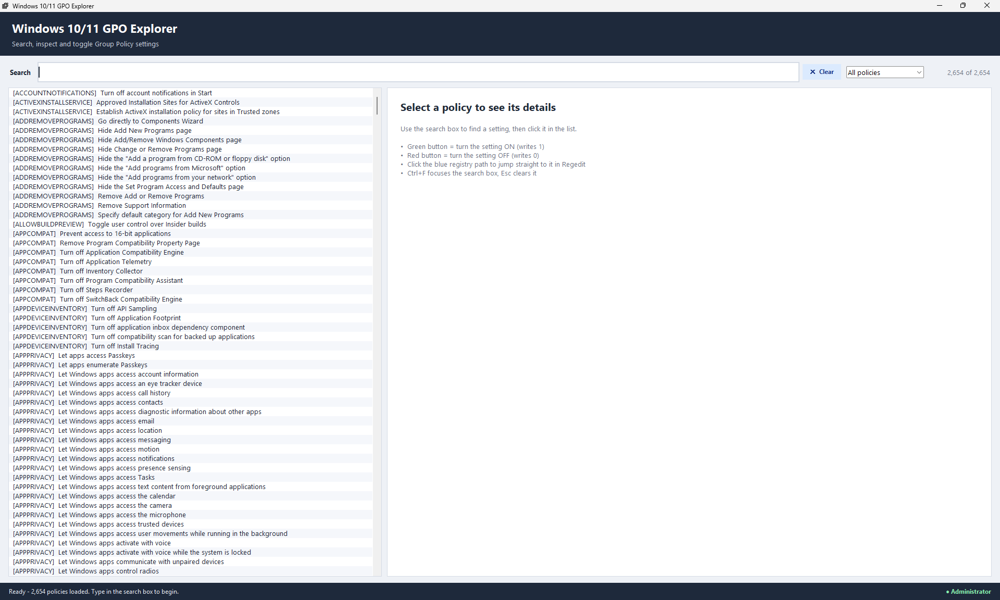
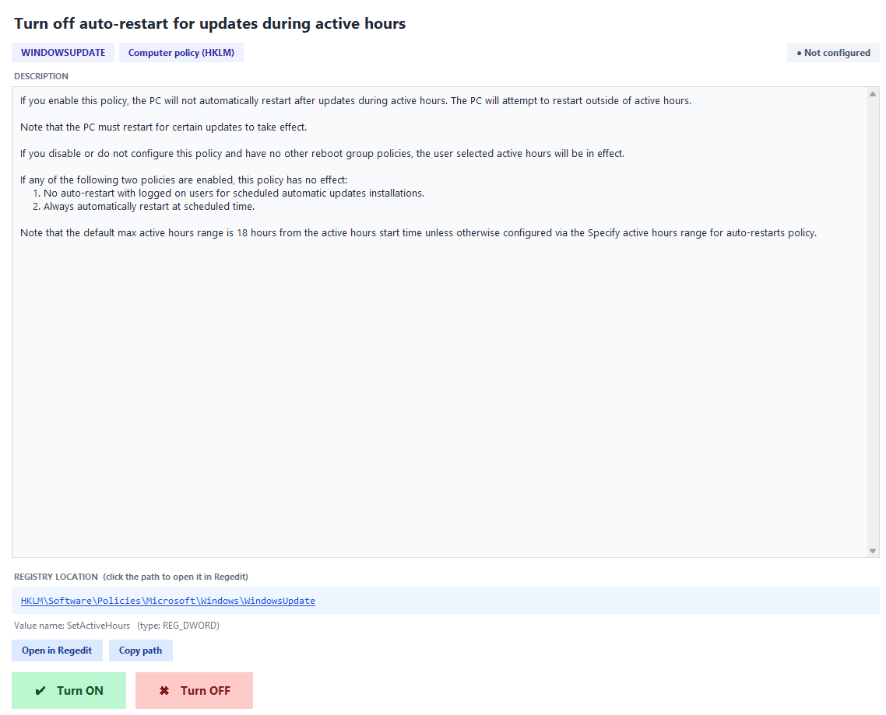

# 🛡️ Windows 11 GPO Explorer

> **Search, inspect and toggle Windows Group Policy settings from one clean, friendly window.**
> No more digging through `gpedit.msc` menus. Type a keyword, click a policy, flip it ON or OFF. ⚡


---

## 📸 Screenshots

### 🖥️ Main window


### 🔧 Policy details and registry jump


---

## ✨ Features

| | Feature | What it does |
|---|---|---|
| 🔍 | **Instant search** | Type one or more words and the list filters as you type. It searches names, descriptions, categories and registry names. |
| 🗂️ | **Scope filter** | Show all policies, only **Computer (HKLM)** policies, or only **User (HKCU)** policies. |
| 📖 | **Plain-English descriptions** | Reads Microsoft's own policy text, so you see exactly what each setting does. |
| 🟢 | **Green Turn ON button** | Writes `1` to the policy's registry value. |
| 🔴 | **Red Turn OFF button** | Writes `0` to the policy's registry value. |
| 🏷️ | **Live status badge** | Shows whether the policy is currently **ON**, **OFF** or **Not configured**. |
| 🔗 | **Click-to-open registry path** | Click the blue path to jump straight to that key in **Regedit**. |
| 📋 | **Copy path** | One click copies the registry path to your clipboard. |
| 🪟 | **Smart window** | Opens full screen. Restore-down gives a centered window that is 25% smaller than your screen. |
| 🚨 | **Clear error messages** | Problems print in PowerShell/CMD, so it's easy to see what went wrong. |

---

## 📋 Requirements

- 🪟 **Windows 10 or 11**
- 🐍 **Python 3.8 or newer**, from [python.org](https://www.python.org/downloads/) (Tkinter is included)
- 👑 **Administrator rights** to turn policies ON/OFF (searching works without them)
- 📦 **No extra packages to install**. It only uses Python's standard library.

---

## 🚀 Quick Start

**1️⃣ Download** this repository (green **Code** button, then **Download ZIP**) or clone it:

```powershell
git clone https://github.com/<your-username>/<your-repo>.git
cd <your-repo>
```

**2️⃣ Open PowerShell as Administrator** 👑
Start menu, type `PowerShell`, right-click, **Run as administrator**.

**3️⃣ Run it:**

```powershell
python gpsearcher.py
```

That's it! 🎉

---

## 🧭 How to Use

1. 🔍 **Search.** Type a word like `update`, `telemetry` or `consumer` in the search box.
2. 👆 **Click a policy** in the list on the left.
3. 📖 **Read the description** on the right to see what it does.
4. 🏷️ **Check the badge** to see the current state.
5. 🟢 / 🔴 **Click Turn ON or Turn OFF** to apply it. The status bar at the bottom confirms the change.
6. 🔗 **Click the blue registry path** to open that exact key in Regedit.

### ⌨️ Keyboard shortcuts

| Key | Action |
|---|---|
| `Ctrl` + `F` | Jump to the search box |
| `Esc` | Clear the search |

---

## 🎨 Color Guide

| Color | Meaning |
|---|---|
| 🟩 **Light green** | Turn ON, or "Currently ON (1)" |
| 🟥 **Light red** | Turn OFF, or "Currently OFF (0)" |
| ⬜ **Grey** | Not configured, or button unavailable |
| 🟦 **Blue** | Clickable registry path and helper buttons |
| 🟨 **Amber** | Warning, or an unexpected value |

---

## ⚙️ How It Works

```
C:\Windows\PolicyDefinitions\*.admx   ➜  policy names, registry keys, value names
C:\Windows\PolicyDefinitions\en-US\*.adml  ➜  friendly names and descriptions
                    │
                    ▼
        📚 Built-in policy database  ➜  🔍 searchable list  ➜  🖱️ you click
                    │
                    ▼
        🗝️ Registry write (REG_DWORD 1 or 0) under HKLM / HKCU \ ...\Policies
```

- 📂 Windows ships its Group Policy definitions as `.admx` (settings) and `.adml` (text) files. This tool reads them and builds a searchable list on startup.
- 🧰 A couple of built-in fallback policies are always available, even if the scan fails.
- 🗝️ Toggling a policy writes a `REG_DWORD` value to the 64-bit registry view.

---

## ⚠️ Important Notes

> [!WARNING]
> This tool **changes your Windows registry**. Please read this section. 🙏

- 💾 **Back up first.** Create a restore point or export the key from Regedit before making changes.
- 🔢 **ON writes `1` and OFF writes `0`.** Most policies work this way, but a few Microsoft policies use different or inverted values. If unsure, check the policy in `gpedit.msc`.
- 🧩 **Policies with sub-settings are view-only.** Some policies use several options instead of a single value. These show their info, but the ON/OFF buttons are disabled.
- 🏢 **Domain-joined PCs:** Group Policy from your organization can overwrite your local changes at the next policy refresh. Ask your IT team if a setting keeps reverting.
- 🔄 **Some changes need a sign-out or restart** before Windows applies them.
- 🔗 **Opening Regedit** may show a Windows UAC prompt if the script isn't elevated.

---

## 🩺 Troubleshooting

| Problem | Fix |
|---|---|
| 🚫 `Access Denied` when clicking ON/OFF | Run PowerShell **as Administrator**. |
| 🐍 `python` is not recognized | Reinstall Python and tick **"Add Python to PATH"**. |
| 🪟 `Could not start Tkinter` | Reinstall Python and make sure **tcl/tk** is selected. |
| 📭 Only 2 policies show up | The policy folder wasn't found. Check the `[WARN]` message in the console. |
| 🔁 A setting keeps reverting | A domain Group Policy is probably overriding it. |
| 🔗 Regedit opens at the wrong key | Close any open Regedit window, then click the path again. |

💡 **Tip:** Any error is printed in your PowerShell window with a `[WARN]` or `[ERROR]` tag, which makes bug reports much easier.

---

## 📁 Project Structure

```
📦 your-repo
 ┣ 📜 gpsearcher.py     ← the app
 ┣ 📜 README.md         ← you are here
 ┗ 📂 assets
    ┣ 🖼️ image1.png     ← main window screenshot
    ┗ 🖼️ image2.png     ← policy details screenshot
```

---

## 🤝 Contributing

Ideas, bug reports and pull requests are welcome! 💬

1. 🍴 Fork the repo
2. 🌿 Create a branch: `git checkout -b my-cool-feature`
3. 💾 Commit your changes
4. 📤 Push and open a Pull Request

---

## 📄 License

Released under the **MIT License**. See the [`LICENSE`](LICENSE) file for details.

---

<p align="center">
  Made with ❤️ and 🐍 for Windows tinkerers<br>
  ⭐ If this saved you time, consider giving it a star!
</p>
